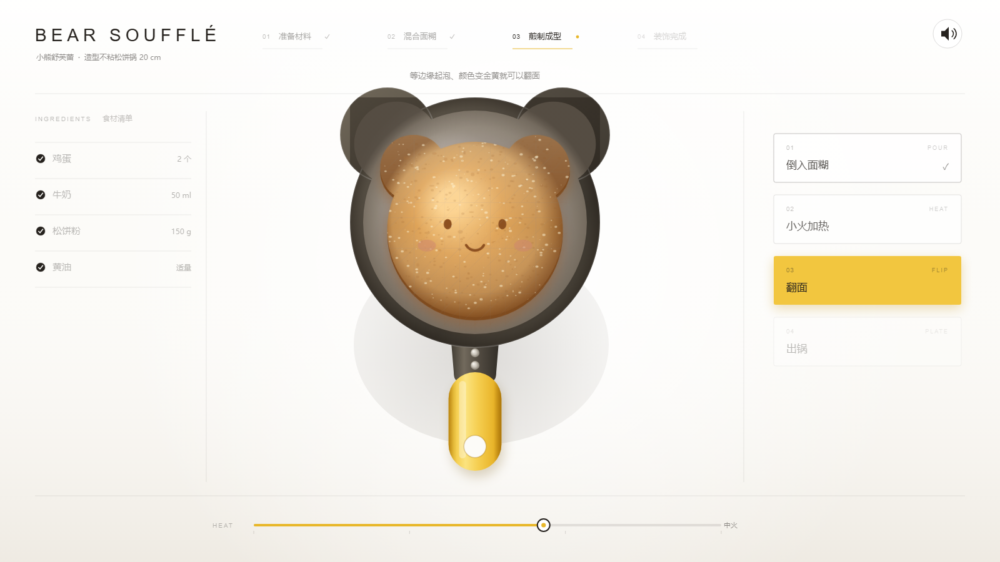
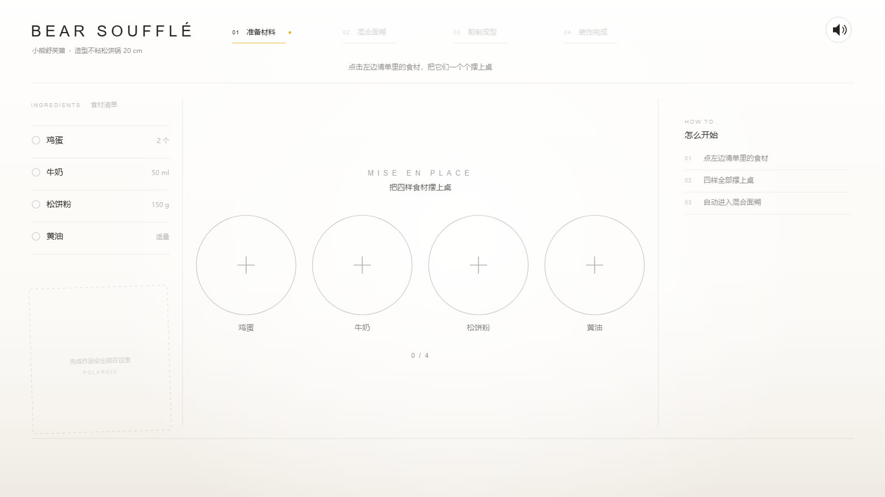
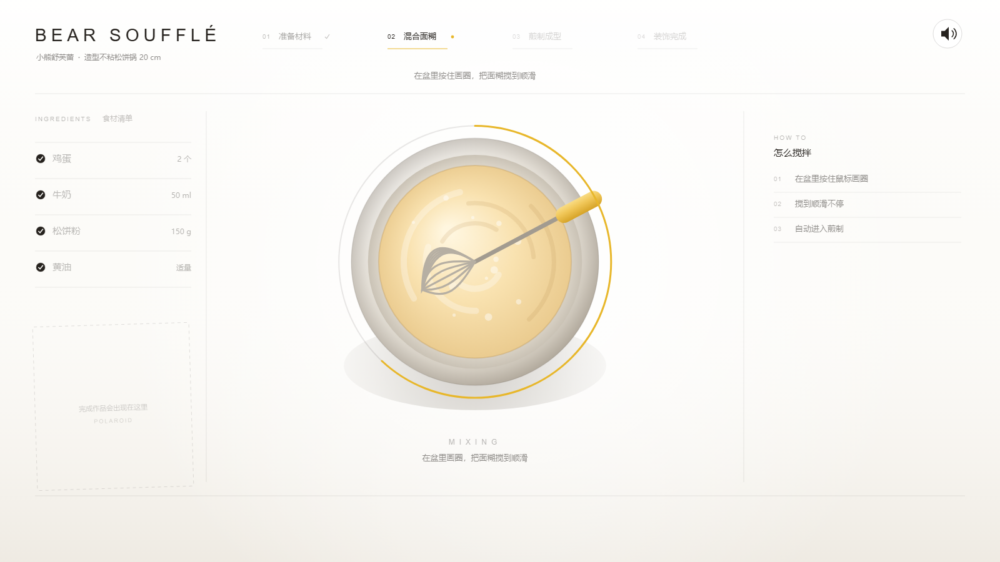
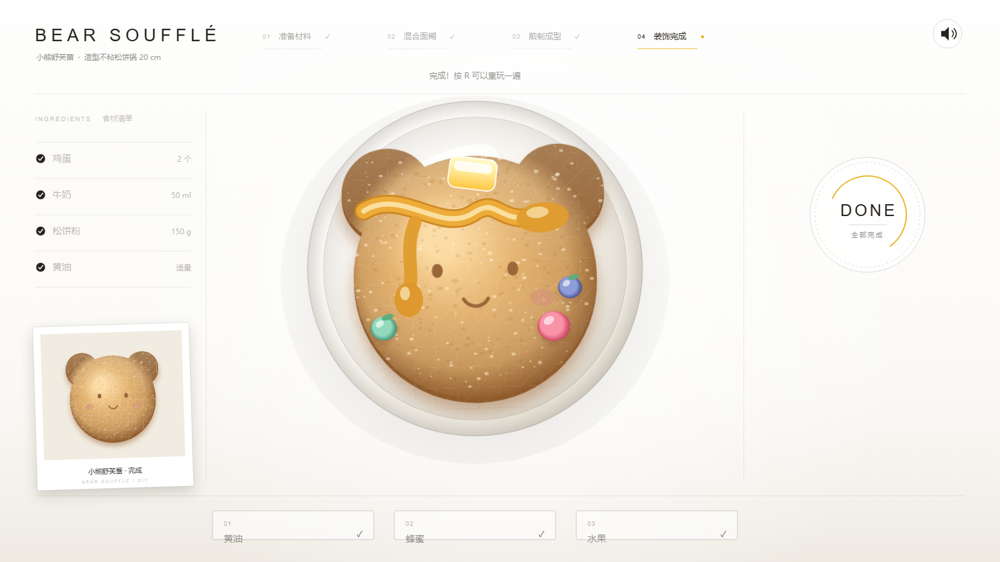

# BEAR SOUFFLÉ · 小熊舒芙蕾

一个用单个 HTML 文件写成的造型松饼锅料理小游戏。俯视视角，深灰不粘锅配黄色手柄，四步做出一只小熊形状的舒芙蕾松饼。

画面里没有任何图片素材——锅、饼、蜂蜜、盘子、食材图标全部由 Canvas 2D 实时绘制。松饼是可以按的：手指按下去会局部塌陷，松手弹回来。



## 玩法

| 步骤 | 操作 |
| --- | --- |
| 01 准备材料 | 点左侧清单里的四样食材，把它们摆上桌 |
| 02 混合面糊 | 在盆里按住鼠标画圈，进度环走满即完成 |
| 03 煎制成型 | 依次点「倒入面糊 → 小火加热 → 翻面 → 出锅」，底部滑条调火力 |
| 04 装饰完成 | 放上黄油、蜂蜜、水果，生成成品拍立得 |

任何阶段按 `R` 重玩。右上角圆钮是静音开关。

## 预览

| 准备材料 | 混合面糊 | 煎制成型 | 装饰完成 |
| --- | --- | --- | --- |
|  |  |  |  |

## 运行

双击 `index.html` 即可。无需安装、无需联网、无构建步骤。

推荐 Chrome / Edge（`ctx.letterSpacing` 和 Web Audio 支持最完整）。窗口按 16:9 显示效果最好，其他比例会自动等比缩放并居中。

## 技术要点

- **软体形变**：18×18 弹簧网格，每个节点带位置与速度，指针按压力度驱动形变，阻尼回弹。
- **网格贴图**：松饼正面纹理先烘焙成 512×512 位图，再按三角形逐片做仿射变换贴到形变网格上，三角形按重心外扩 1.4% 以消除接缝。
- **熟度系统**：正面煎 → 翻面 → 反面煎，按火力与时间累积，颜色和焦斑纹理分 12 档缓存，避免每帧重绘。
- **音效**：Web Audio 现场合成振荡器与带通噪声，没有音频文件。首次点击后初始化 AudioContext。
- **零依赖**：没有框架、没有打包、没有外部字体与图片，全部代码在一个 `<script>` 里。

## 文件结构

```
index.html              主程序（实拍质感版）
legacy/v1-y2k.html      旧版：千禧 Y2K 风格，糖果色 + 镭射渐变，功能一致
legacy/ambient-9x16.html  竖屏 9:16 自动循环动画（约 22 秒），适合直接录屏
screenshots/            两个版本四个步骤的截图
```

## 想改的话

用编辑器打开 `index.html`，主要入口：

- `LAY` — 所有元素的位置与尺寸（锅、盆、按钮、滑条、成品卡）
- `ING` — 食材名称、用量、摆位
- `STEPS` — 顶部四个步骤名
- `drawPan()` / `drawBowl()` / `drawButtons()` — 锅、盆、按钮的绘制
- `INK` / `INK2` / `INK3` / `ACC` — 配色常量，`ACC` 是那根黄色（`#E8B72A`）

## License

个人项目，未指定开源协议。
